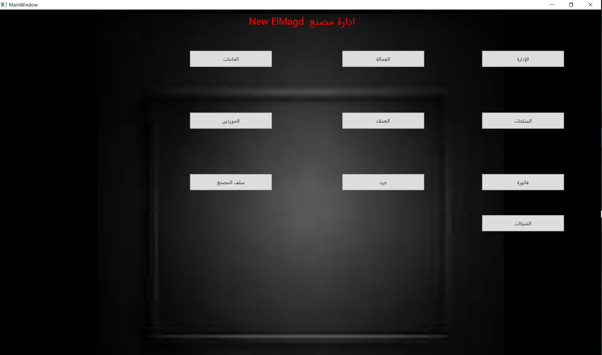

<!-- ═══════════════ HEADER ═══════════════ -->


<div align="center">


<br/>

**From the production floor to the books: one system for people, work and money.**

[Overview](#-overview) · [Features](#-features) · [Demo](#-video-demo) · [Screenshots](#-screenshots) · [Tech](#%EF%B8%8F-technology-stack) · [Contact](#-contact)

</div>

---

## 🏭 Overview

**NewElMagd System** is a desktop application built for **clothing factories**.

Factories pay many workers **by the piece**, buy from many suppliers, and sell to many customers, often tracked on paper or in scattered spreadsheets. NewElMagd brings it all into one place: it records each worker's daily output, calculates what they earned, keeps supplier and customer accounts, tracks payments and checks, and turns it all into clear reports.

<table>
<tr>
<td align="center" width="25%">👷<br/><b>Workers</b><br/><sub>Profiles and daily output</sub></td>
<td align="center" width="25%">🧵<br/><b>Production</b><br/><sub>Pieces, piece price, date</sub></td>
<td align="center" width="25%">💳<br/><b>Finance</b><br/><sub>Suppliers, customers, checks</sub></td>
<td align="center" width="25%">📊<br/><b>Reports</b><br/><sub>Performance and money at a glance</sub></td>
</tr>
</table>

---

## ✨ Features

<table>
<tr>
<td width="50%" valign="top">

### 👷 Employee management
- Add, update and view employee information
- One place for every worker's details

</td>
<td width="50%" valign="top">

### 🧵 Daily work tracking
- Record **pieces produced**, **piece price** and **work date**
- A clear view of each employee's productivity and earnings

</td>
</tr>
<tr>
<td width="50%" valign="top">

### 💳 Financial management
- **Supplier payments** and balances
- **Customer transactions**
- **Check handling**, from issue to collection

</td>
<td width="50%" valign="top">

### 📊 Reports
- Employee performance
- Financial transactions
- Supplier activity
- Insights to improve daily operations

</td>
</tr>
</table>

---

## 🎬 Video demo

See the system in action:

https://github.com/user-attachments/assets/0eb54b47-165c-4f20-a1ff-30a3f5df7e80

---

## 📷 Screenshots

<div align="center">

<p><sub>Main screen</sub></p>
</div>

---

## 🛠️ Technology stack

| Layer | Technology |
|---|---|
| Language | **C#** |
| User interface | **WPF** |
| Framework | **.NET Framework 4.7.1** |
| Database | **SQL Server** |
| Data access | **ADO.NET**: direct, fast SQL access with full control over queries |
| Platform | **Windows** desktop |

```
NewElMagd System
├── WPF screens     → employees, daily work, suppliers, customers, checks, reports
├── Business logic  → earnings, balances, report calculations
└── SQL Server      → accessed through ADO.NET
```

---

## 📬 Contact

Interested in this system for your factory, or in a custom version?

<div align="center">

<a href="https://www.linkedin.com/in/ahmed-toba-7378b0206/"></a>
<a href="mailto:ahmedtobashahban21@gmail.com"></a>

<br/><br/>

<sub>Built by <a href="https://github.com/ahmedtobashahban21">Ahmed Toba Shaban</a></sub>

</div>


